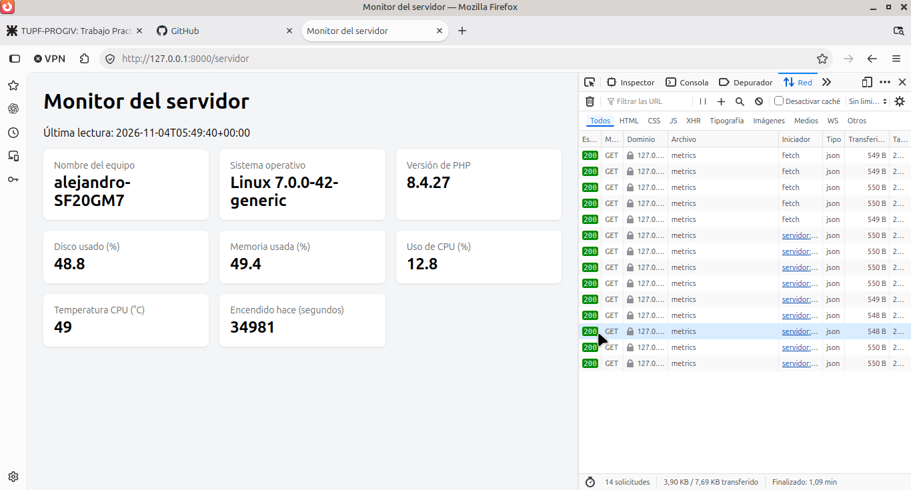
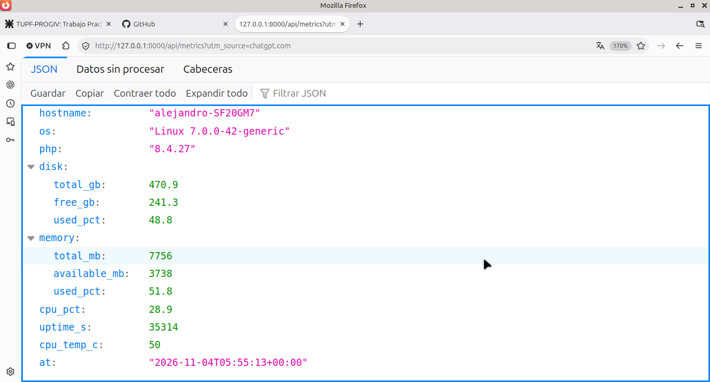

# Monitor de Servidor con Laravel

**Programación IV · UTN FRRe · Cohorte 2026**

Aplicación Laravel que lee datos del sistema operativo del servidor y los expone de dos formas: una
vista web (`/servidor`) y una API JSON (`/api/metrics`). El mismo dato sale de una sola clase —
`App\Services\ServerMetrics` — que la vista, la API y los próximos trabajos (GraphQL, WebSockets)
reutilizan sin modificarla.

## Datos que lee

Nombre del equipo, sistema operativo, versión de PHP, uso de disco, uso de memoria, uso de CPU,
tiempo encendido (uptime) y temperatura de la CPU.

## Sistema operativo usado (desafío opcional del TP)

El TP base lee los datos en **Windows** con PowerShell + WMI. Este proyecto resuelve el **desafío
opcional del final**: el service está implementado completamente para **Linux**, leyendo los datos de
los archivos del sistema que indica la consigna.

Se desarrolló y probó en:

| Ítem | Valor |
|---|---|
| Sistema | **Linux Mint 22.3 ("Zena")** (base Ubuntu) |
| Kernel | 7.0.0-42-generic |
| PHP | 8.4 |
| Fuente de memoria | `/proc/meminfo` (MemTotal, MemAvailable) |
| Fuente de CPU | `/proc/stat` (dos lecturas separadas para calcular el uso) |
| Fuente de uptime | `/proc/uptime` |
| Fuente de temperatura | `/sys/class/thermal/thermal_zone*/temp` |

Cada dato que no puede leerse queda en `null` y la vista lo muestra como "No disponible"; la app
nunca se rompe.

## Cómo ejecutar

```sh
php artisan serve
```

- Vista web: <http://127.0.0.1:8000/servidor> (se actualiza sola cada 5 s)
- API JSON: <http://127.0.0.1:8000/api/metrics> (máximo 60 pedidos por minuto)

Verificación rápida del servicio desde consola:

```sh
php artisan tinker
app(App\Services\ServerMetrics::class)->snapshot();
```

## Estructura

| Parte | Responsabilidad | Archivo |
|---|---|---|
| Service | Cómo se obtienen los datos | `app/Services/ServerMetrics.php` |
| Controlador | Qué se responde y en qué formato | `app/Http/Controllers/ServerController.php` |
| Vista | Cómo se muestran los datos | `resources/views/servidor.blade.php` |
| Rutas | Puertas de entrada web y API | `routes/web.php`, `routes/api.php` |

## Actualización automática (polling)

La vista se actualiza sin recargar la página: el navegador le pide los datos a la API cada 5 segundos
(`setInterval` + `fetch`). Con el polling la mayoría de los pedidos son inútiles cuando los datos no
cambiaron; es el problema que resuelven los WebSockets en el próximo TP.

## Respuestas a las preguntas

### 1. ¿Por qué la temperatura suele aparecer como "No disponible" en Windows?

Porque el dato viene de la clase WMI `MSAcpi_ThermalZoneTemperature` y casi nunca es accesible desde
un proceso normal. WMI la bloquea por seguridad si el proceso (terminal, PHP) no corre con permisos de
administrador, y además la placa madre tiene que exponer el sensor ACPI: en muchos equipos la clase
directamente no existe. Si `Get-CimInstance` falla por cualquiera de esas dos causas, el script
devuelve `null` y la vista muestra "No disponible". Si se abriera la terminal como administrador y la
placa informara el sensor, el dato aparecería; si la placa no lo informa, sigue `null` aunque seamos
administradores. En nuestra máquina el desafío opcional lo resuelve en Linux: la temperatura se
lee de `/sys/class/thermal/thermal_zone*/temp`, sin necesidad de permisos de administrador.

### 2. ¿Por qué el script de PowerShell nunca debe incluir datos que vengan del usuario?

Porque `shell_exec()` ejecuta comandos en el servidor: si se arma el comando interpolando entrada del
usuario (formularios, URL, etc.), un atacante puede escribir PowerShell y ejecutar cualquier cosa en
la máquina — leer archivos, borrar datos o instalar malware — con los permisos del proceso PHP. Es la
inyección de comandos, el equivalente server-side de la SQL injection. Acá el riesgo se evita porque
el script es una constante fija del código: nunca se concatena nada que venga del request, y se
entrega ya codificado en Base64 (`-EncodedCommand`), de modo que PowerShell no interpreta caracteres
especiales de la línea de comandos.

### 3. ¿Qué riesgo tiene dejar `/api/metrics` sin autenticación en un servidor real?

Expone información de infraestructura a cualquiera: versión exacta de PHP y del SO (sirve para
rastrear versiones con vulnerabilidades conocidas), carga de CPU, memoria y disco (permite saber
cuándo la máquina está estresada y planificar un ataque DoS), uptime (revela si el servidor está sin
parchear desde un reinicio viejo) y hasta la topología del equipo (hostname). Con esa foto un
atacante arma un plan de ataque sin interactuar con nadie. En producción se protege con
autenticación, por ejemplo `->middleware('auth:sanctum')`, y el rate limit (`throttle:60,1`) evita
que un bot consuma CPU del servidor (cada pedido dispara PowerShell). En este TP queda abierta solo
con fines didácticos.

### 4. Con polling cada 5 segundos, ¿cuántos pedidos por minuto recibe el servidor si hay 50 personas mirando?

Cada persona genera 1 pedido cada 5 segundos = 12 pedidos por minuto. Con 50 personas mirando:
**50 × 12 = 600 pedidos por minuto** (10 por segundo), aunque casi ningún dato haya cambiado entre
pedidos. Por eso el próximo TP usa WebSockets: una sola conexión persistente por visitante y el
servidor avisa solo cuando hay un dato nuevo, sin pedir nada.

### 5. Si una app solo necesita la temperatura, ¿qué datos recibe de más al llamar a `/api/metrics`?

Recibe todos los campos: `hostname`, `os`, `php`, `disk` completo, `memory` completo, `cpu_pct` y
`uptime_s`, aunque solo le importe `cpu_temp_c`. Eso es **over-fetching**: la API REST estática
entrega siempre el mismo objeto y no permite elegir campos. GraphQL resuelve justo eso — el cliente
especifica en la query qué campos quiere y recibe únicamente esos. Además de ancho de banda
desperdiciado, es más superficie de exposición de datos sensibles (hostname, versiones del SO).

## Capturas de la entrega

**Vista web `/servidor` con el polling visible** (panel Red de Firefox: un pedido a la API cada 5 segundos):



**API JSON `/api/metrics`:**



## Entrega

- [x] Proyecto Laravel con service, vista y API funcionando
- [x] Actualización automática por polling
- [x] README con sistema operativo usado y respuestas
- [x] Link al repositorio de GitHub: <https://github.com/Alejaquiroga/TP-Monitor-de-servidor-con-Laravel>
- [x] Captura de `/servidor` funcionando (con polling en Red)
- [x] Captura de la respuesta de `/api/metrics`
